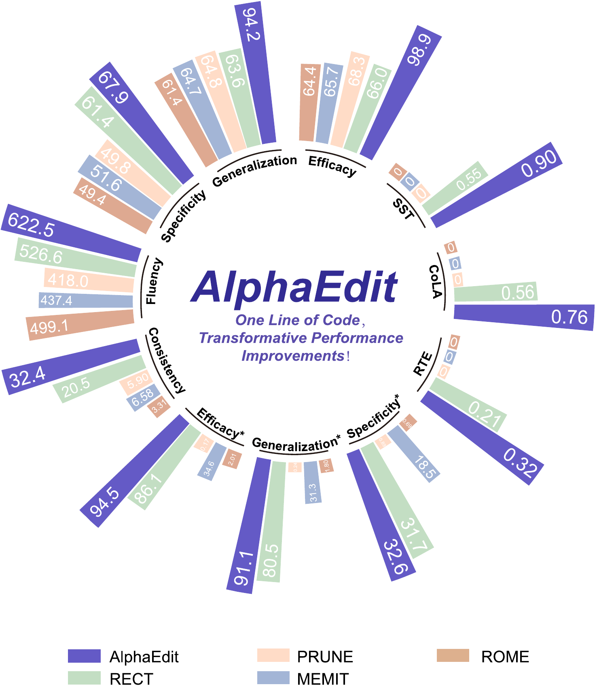
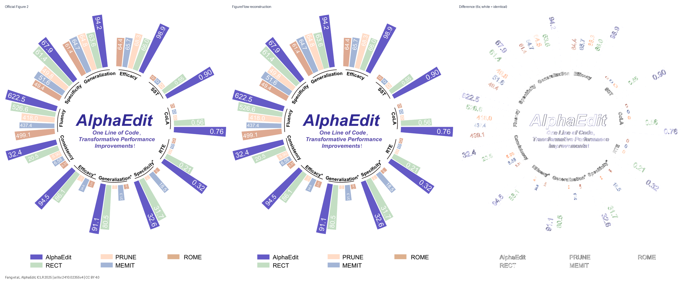

# AlphaEdit Figure 2：忠实重建与数据驱动绘图

本案例以 [AlphaEdit 论文 v4](https://arxiv.org/abs/2410.02355v4) 的 Figure 2 为参考，把原图的程序化重建、55 个已发表数值、来源核对、可替换数据的绘图模块和执行提示词放在同一目录中。



来源：Junfeng Fang、Houcheng Jiang 等，AlphaEdit，ICLR 2025，Figure 2，CC BY 4.0。上图是 FigureFlow 的矢量重建；没有重新运行模型实验。原图中的小字号和部分浅色柱上的低对比文字被保留。完整归属、版本及四处图表数值差异见 [SOURCES.md](SOURCES.md)。

## 选择模式

| 模式 | 输入与计算方式 | 适合的任务 |
|---|---|---|
| `faithful` 忠实重建 | 从官方 Illustrator PDF 数字化得到 71 个路径和 555 个字形实例，程序重新组成 SVG/PDF/PNG；55 个数值标签与 PDF 白字及其字形单独绑定核验 | 复现原图的布局、柱形、配色和排版 |
| `data-driven` 数据驱动 | 读取可替换 CSV，按输入数值重新计算柱长，逐指标分析；支持环形柱图和常规分面图 | 用同类视觉语言绘制自己的数据，或分析已发表数值 |

忠实模式是 FigureFlow 编写的源图数字化重建程序，不是作者发布的绘图源代码，也不是从 CSV 推导原图的手工柱长。修改案例数据后不能继续套用固定原图几何；需要切换到数据驱动模式。两种模式均为本地离线执行，不需要 API Key 或额外模型调用。

## 一键重建

在 FigureFlow 仓库根目录，使用 Python 3.10 或更高版本：

```bash
python -m pip install -r requirements-reproduction.txt
# macOS 系统依赖；已有环境可跳过：
brew install cairo poppler
python -m demo_core.alphaedit_reproduction --output-dir demo/output/alphaedit_figure2
```

Linux 对应的系统依赖通常为 `libcairo2` 和 `poppler-utils`。Cairo 用于矢量导出，Poppler 的 `pdftoppm` 用于在相同 DPI 下渲染原图和结果。普通重建直接读取已提交的 `scene.json`，不需要 PyMuPDF。

输出目录包含：

- `alphaedit_figure2.svg`、`.pdf`、`.png`：重新生成的图；
- `reference.png`、`comparison.png`：原图渲染和同尺寸差异对照；
- `report.json`、`manifest.json`：数量、像素比较、证据状态、许可和哈希；
- 数据、场景、来源审计及 [PROMPTS.md](PROMPTS.md) 的副本；
- `reproduction.zip`：结果与 `replay/` 最小可运行目录，入口见包内 `REPLAY.txt`。解压后在 `replay/` 安装所列依赖，即可离线重新输出。

忠实图的画布不另加水印。`published-figure` 状态和署名保留在本页说明、SVG/PDF metadata、PDF 所附数据和来源文件、manifest 中，分享时请一并保留。

## 使用 CSV 分析和重新画图

需要一次生成全部模式、实际论文列宽预览和总览图时：

```bash
python scripts/build_alphaedit_demo.py --output-dir demo/output/alphaedit_demo
```

它会生成 `exact/`、`data/`、`analysis/` 三个目录，以及直接合并矢量 PDF 的 A4 页面（每列 3.25 英寸）、`gallery.png` 和相对路径/哈希清单。查看[完整 demo 总览](demo_gallery.png)与[纸面预览](paper_preview.pdf)。纸面预览明确展示原图小字的继承限制，不把它误判为新图的最低字号合格证明。

```bash
python -m demo_core.data_analysis cases/alphaedit_figure2/data.csv \
  --chart annular --title AlphaEdit --focus-method AlphaEdit \
  --output-dir demo/output/alphaedit_data

python -m demo_core.data_analysis cases/alphaedit_figure2/data.csv \
  --chart small-multiples --title AlphaEdit --focus-method AlphaEdit \
  --output-dir demo/output/alphaedit_small_multiples
```

替换位置参数为自己的本地 CSV。必需字段为 `metric,method,value`；建议同时提供 `label,source,evidence_status`。`label` 是数值显示字符串，可保留 `5.90`、`0.90` 等格式，必须与 `value` 数值一致。当前案例为 `published-figure`；用户输入默认是 `user-supplied`。只有确有重新测量的数据，才应由提供者声明为 `remeasured`。

每个指标必须包含全部方法。程序拒绝重复组合、缺失、非有限数值和不一致的数值标签，不插补数据。环形图仅接受非负值；负值、长指标名或精确对比优先使用分面图。需要“越低越好”时，对每个相关指标传入 `--lower-is-better "Metric name"`；默认是越高越好。

环形图对**每个指标独立按其最大值缩放**，零值表示为基线短刻度，不画出虚假的正值柱。分面图保留原始数值，各面板坐标轴独立。分析报告只给出逐指标排名、目标方法相对最佳其他方法的差值及相对差值，不平均不同量纲，不推断误差条、样本数或统计显著性；比较基线为零时，相对差值记为未定义。

数据驱动输出包含图的 SVG/PDF/PNG、规范化 CSV、`*_analysis.json`、`*_audit.md`、manifest 和仅含本次结果的 ZIP。它的柱长依据公开缩放规则重算，视觉上不会与忠实模式完全相同。

## 通过安装的 skill 调用

```bash
python /path/to/design-research-figures/scripts/render_publication_data.py \
  --figureflow-root /path/to/FigureFlow --case alphaedit-figure2 \
  --output-dir /path/to/output/reproduction

python /path/to/design-research-figures/scripts/render_publication_data.py \
  --figureflow-root /path/to/FigureFlow --csv /path/to/data.csv \
  --kind annular --title AlphaEdit --focus-method AlphaEdit \
  --output-dir /path/to/output/data
```

安装版 skill 通过这个入口调用 FigureFlow checkout 中的模块。它需要 `--figureflow-root` 指向可用仓库；仅复制 skill 文件夹不能带走本案例的全部运行代码和素材。

## 核验忠实程度



[report.json](report.json) 记录当前比较结果。在相同 240 DPI、Poppler CropBox、无缩放对齐或额外补白的检查中，全画布像素完全一致比例约为 97.68%，前景平均绝对通道误差约为 4.55/255。大面积白底会提高全画布一致比例，因此不把它表述为“97.68% 精确复现”；应同时查看前景误差与放大差异图。字体轮廓和抗锯齿仍有微小差异，并非逐像素 100% 相同。实际指标以所交付版本的报告为准。

对原图小字号、白字低对比等缺陷的保留属于忠实模式的边界，不是推荐给新图的排版标准。图形重建本身也不能证明各指标的柱长具有跨指标可比性。

## 可选：从官方 PDF 重新数字化场景

```bash
python -m pip install '.[digitize]'
python scripts/extract_alphaedit_scene.py cases/alphaedit_figure2/reference/intro_part2.pdf
```

该步骤在仓库根目录执行并重新生成本案例的 `scene.json`，不是普通重建的必要步骤。它使用可选 PyMuPDF，适用 AGPL 或商业许可；常规重建依赖见 `requirements-reproduction.txt`。许可细节见 [THIRD_PARTY_NOTICES.md](../../THIRD_PARTY_NOTICES.md)。官方源 PDF、数字化场景和据此生成的预览/图形按 CC BY 4.0 归属；FigureFlow 新编写的程序代码使用 MIT。场景保留已排版字形轮廓，不提供或授权字体软件。
